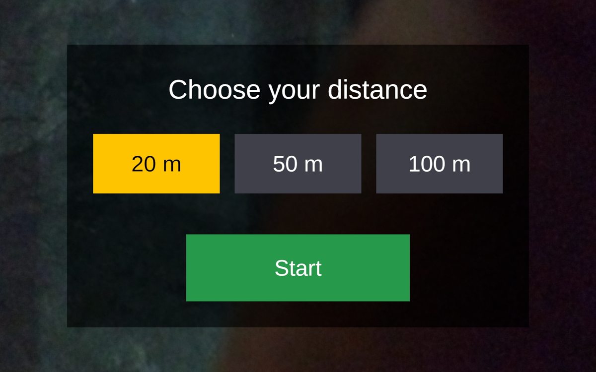
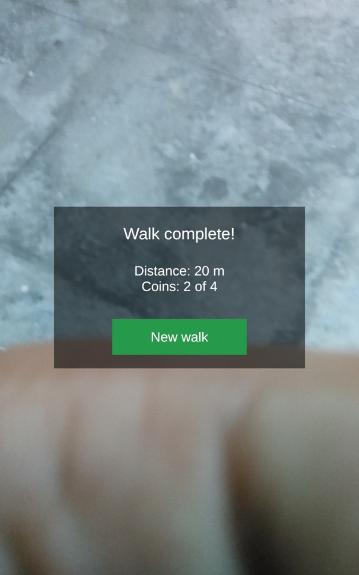
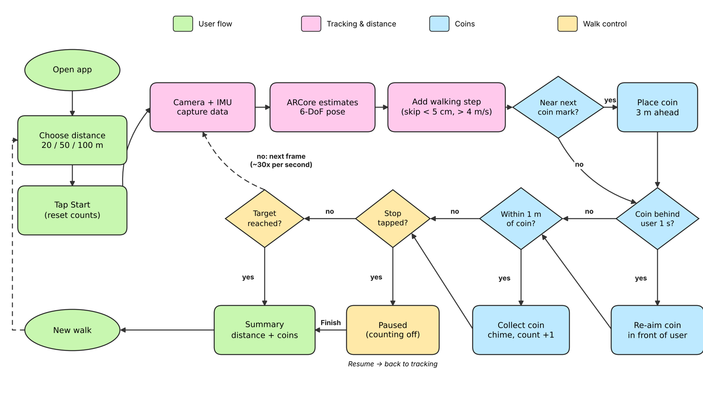
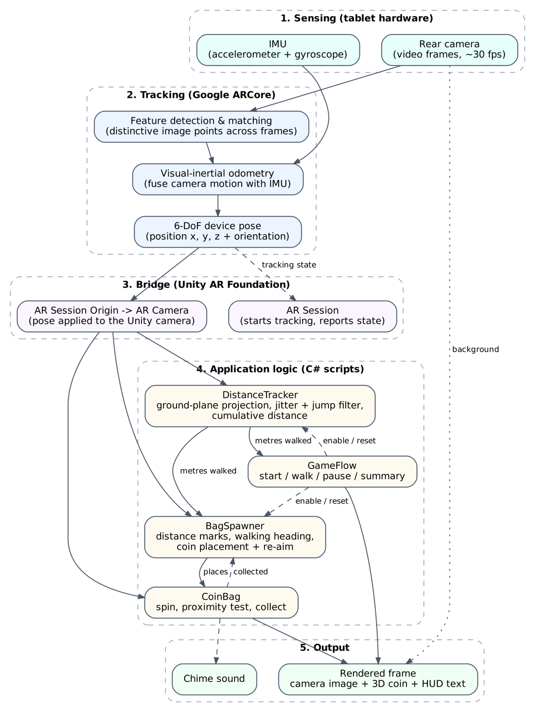
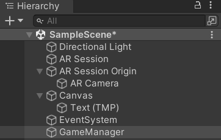
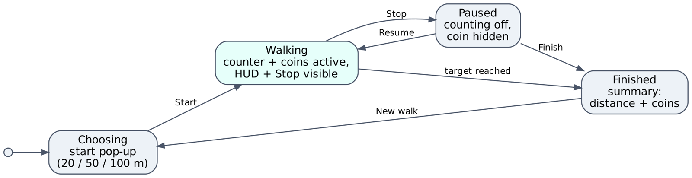
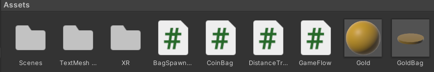
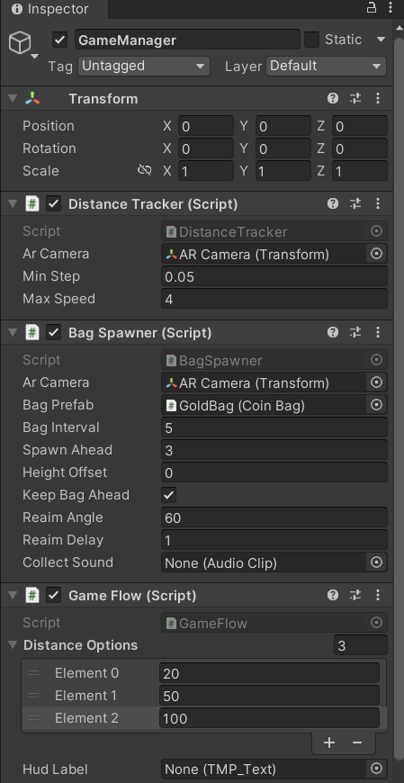

# AR-Jog

**A GPS-free augmented reality walking game built with Unity and ARCore.**

AR-Jog turns an ordinary walk into a game. The user picks a distance, starts walking, and spinning gold coins appear in the real world ahead of them. Walking through a coin collects it with a chime. Walking distance is measured with the device camera and motion sensors, so no GPS is needed and the app also works indoors.

The app was designed for **AR glasses** and is demonstrated on an **Android tablet** (Samsung SM-X216B), which acts as a handheld stand-in for a head-worn display.

<p align="center">
  
  &nbsp;&nbsp;
  
</p>
<p align="center"><em>Start screen (left) and end-of-walk summary (right), shown over the live camera view.</em></p>

> MSc Computer Science, Computer Vision project.

---

## Contents

- [Why AR-Jog](#why-ar-jog)
- [Features](#features)
- [How it works](#how-it-works)
- [Computer vision concepts](#computer-vision-concepts)
- [Distance and coin logic](#distance-and-coin-logic)
- [Architecture](#architecture)
- [Project structure](#project-structure)
- [Getting started](#getting-started)
- [Configuration](#configuration)
- [Limitations](#limitations)
- [Future work](#future-work)

---

## Why AR-Jog

- Walking is the easiest everyday exercise, but it is repetitive and many people lose motivation.
- Fitness apps show only numbers (distance, steps), with no moment-to-moment reward.
- Games like Subway Surfers keep players engaged with collectable rewards, but keep them seated in front of a screen.
- GPS is accurate only to a few metres and works poorly indoors, so it cannot place rewards a few metres apart.

AR-Jog places rewards in the real world and measures distance with **visual-inertial tracking** instead of GPS.

## Features

- **Choose a distance:** 20 m, 50 m or 100 m (adjustable in the Unity Inspector).
- **GPS-free distance tracking** using the camera and motion sensors.
- **Spinning gold coins** appear ahead of the user at fixed intervals.
- **Walk-through collection** with an audio chime, no tapping needed.
- **Coin re-aim:** if the user turns around, the coin moves back in front of them.
- **Stop, Resume and Finish** controls, and an end-of-walk summary.
- **Glasses-first design:** no screen touches during the walk, a minimal one-line display at the top edge, and audio feedback.
- **No external assets:** the coin is built from a Unity primitive and the sound is generated in code.

## How it works

<p align="center">
  
</p>

1. **Choose distance:** the user picks 20, 50 or 100 m and taps Start.
2. **Track:** every frame, ARCore uses the camera and motion sensors to find the tablet's position (6-DoF pose).
3. **Measure:** `DistanceTracker` adds up horizontal movement, ignoring hand jitter and tracking jumps.
4. **Spawn:** near each 5 m mark, `BagSpawner` places a coin 3 m ahead along the walking direction.
5. **Re-aim:** if the user turns away, the coin moves back in front of them after 1 second.
6. **Collect:** within 1 m of the coin, it disappears with a chime and the coin count rises.
7. **Finish:** at the target distance, or via Stop → Finish, a summary shows distance and coins.

Steps 2 to 6 repeat every frame, about 30 times per second.

### Processing pipeline

<p align="center">
  
</p>

## Computer vision concepts

| Concept | What it is | Where and how it is applied |
|---|---|---|
| **Feature detection & tracking** | Finds distinctive image points (corners, textures) and matches them across frames | ARCore tracks these points in the camera feed to work out how the device moved |
| **Visual-inertial odometry (VIO)** | Fuses camera motion with IMU (accelerometer + gyroscope) data, giving real scale in metres | Gives the tablet's position in metres, which `DistanceTracker` sums into walking distance |
| **SLAM** | Builds a map of feature points while locating the camera in it, creating a stable world frame | Coins are placed in this world frame, so they stay fixed in the real room |
| **6-DoF pose estimation** | Device position (x, y, z) and orientation (pitch, yaw, roll), every frame | Applied to the AR Camera; scripts read its position for distance, heading and collection |
| **Pinhole camera model** | Maps a 3D point to a 2D pixel using the camera's focal length and centre | The AR Camera uses the tablet's real camera parameters to draw the coin at the correct pixel |
| **Registration** | Aligns virtual objects with the real scene and draws them over the camera image | The coin appears to hover in the real corridor and grows larger as the user approaches |

Feature tracking, VIO and SLAM run inside ARCore. The project builds on ARCore's pose output with the processing below.

## Distance and coin logic

**Distance calculation**

```
Distance = Σ √(Δx² + Δz²)     // sum of horizontal steps between frames
```

Height (y) is ignored, so raising or lowering the tablet adds nothing.

**Noise filtering**

- **Dead-band:** moves under 5 cm are not counted yet, to remove hand jitter.
- **Velocity gate:** moves faster than 4 m/s are rejected as tracking jumps.
- **Tracking check:** nothing is counted while ARCore is not tracking.

```csharp
float step = Vector3.Distance(position, lastPosition);
if (step < minStep) return;                              // jitter: wait
bool isJump = step > maxSpeed * (Time.time - lastTime);
if (!isJump) DistanceMetres += step;                     // count real walking
lastPosition = position;  lastTime = Time.time;
```

**Heading estimation:** the walking direction is taken from actual movement every 0.5 m, not from where the tablet points.

**Coin placement and re-aim**

- Coin position = current position + heading × metres left to the mark.
- A coin is re-aimed if it is more than 60° off the walking direction for 1 second.

**Collection:** a proximity test, horizontal distance under 1 m.

## Architecture

### Tools and platform

| Component | Details |
|---|---|
| Engine | Unity 2021.3.18f1 (LTS), 3D Built-in Render Pipeline |
| Language | C# |
| Target | Android (ARCore-supported device) |
| Test device | Samsung Android tablet, SM-X216B |

### Plugins and packages

| Package | Role |
|---|---|
| **AR Foundation** | Unity's AR layer; gives scripts the device position and tracking state |
| **Google ARCore XR Plugin** | Connects AR Foundation to Google's ARCore tracking on Android |
| **XR Plug-in Management** | Switches ARCore on when the app starts |
| **TextMeshPro** | On-screen text (distance, coins, pop-ups) |
| **Unity UI** | Buttons and pop-up panels |
| **Google Play Services for AR** | ARCore runtime installed on the device |

### Scene components

<p align="center">
  
</p>

| Object | Role |
|---|---|
| **AR Session** | Starts and manages AR tracking |
| **AR Session Origin** | Links the real world to Unity's coordinate system |
| **AR Camera** | Moves exactly like the real tablet and shows the live camera feed |
| **Canvas** | Holds the on-screen text, pop-ups and Stop button |
| **EventSystem** | Passes screen taps to the buttons |
| **GameManager** | Empty object that holds the scripts |
| **Directional Light** | Lights the 3D coin |

### C# scripts

| Script | Responsibility |
|---|---|
| [`DistanceTracker.cs`](Assets/DistanceTracker.cs) | Reads the AR Camera position and calculates walking distance, ignoring jitter and tracking jumps |
| [`BagSpawner.cs`](Assets/BagSpawner.cs) | Places coins ahead at set distances, re-aims them after turns, and plays the chime |
| [`CoinBag.cs`](Assets/CoinBag.cs) | Makes each coin spin and detects when the user reaches it |
| [`GameFlow.cs`](Assets/GameFlow.cs) | Runs the screens (start, walk, pause, summary) as a state machine and checks when the walk is complete |

<p align="center">
  
</p>

### Assets

<p align="center">
  
</p>

- **GoldBag prefab:** the coin, a flattened Unity cylinder, reused for every coin.
- **Gold material:** the coin's gold colour.
- **Chime sound:** generated in code, so no audio file is used.

## Project structure

```
AR-Jog/
├── Assets/
│   ├── Scenes/SampleScene.unity    # the AR scene
│   ├── DistanceTracker.cs
│   ├── BagSpawner.cs
│   ├── CoinBag.cs
│   ├── GameFlow.cs
│   ├── GoldBag.prefab              # coin template
│   ├── Gold.mat                    # coin material
│   ├── TextMesh Pro/               # TextMeshPro resources
│   └── XR/                         # AR Foundation / ARCore settings
├── Packages/                       # package list (AR Foundation, ARCore, ...)
├── ProjectSettings/                # Unity and Android build settings
└── docs/images/                    # README screenshots and diagrams
```

## Getting started

### Requirements

- **Unity 2021.3.18f1** with **Android Build Support** (SDK, NDK, OpenJDK).
- An **ARCore-supported Android device** with [Google Play Services for AR](https://play.google.com/store/apps/details?id=com.google.ar.core).
- A USB cable, and **USB debugging** enabled on the device.

### Open and build

1. Clone or download this repository.
2. In **Unity Hub**, choose **Add > Add project from disk** and select the `AR-Jog` folder. Unity rebuilds its Library folder on first open, which takes a few minutes.
3. Open **Assets/Scenes/SampleScene**.
4. Go to **File > Build Settings**, select **Android**, and click **Switch Platform** if needed.
5. Connect the device, click **Refresh** next to Run Device, and select it.
6. Click **Build And Run**.

### Build configuration

| Setting | Value | Reason |
|---|---|---|
| XR provider | ARCore | Enables ARCore tracking |
| Graphics API | OpenGLES3 only | The ARCore plugin used does not support Vulkan |
| Minimum API level | 24 (Android 7.0) | Oldest Android version ARCore supports |
| Target API level | 34 (Android 14) | Older targets are blocked by Google Play Protect |
| Scripting backend | IL2CPP | Required for 64-bit builds |
| Target architecture | ARM64 | Recommended for ARCore |

### Using the app

1. Use the app in a well-lit, open, safe space.
2. Allow camera access when asked.
3. Choose a distance and tap **Start**.
4. Hold the tablet steady at chest height and walk forward.
5. Walk through coins to collect them. Tap **Stop** to pause or finish early.

## Configuration

All settings are on the **GameManager** object in the Unity Inspector, so they can be changed without editing code.

<p align="center">
  
</p>

| Script | Setting | Default | Meaning |
|---|---|---|---|
| DistanceTracker | Min Step | 0.05 m | Movements smaller than this are treated as jitter |
| DistanceTracker | Max Speed | 4 m/s | Faster movement is treated as a tracking jump |
| BagSpawner | Bag Interval | 5 m | Distance between coins |
| BagSpawner | Spawn Ahead | 3 m | How far before its mark a coin appears |
| BagSpawner | Keep Bag Ahead | On | Re-aim coins that end up behind the user |
| BagSpawner | Reaim Angle / Delay | 60° / 1 s | When a coin counts as "behind" the user |
| CoinBag | Spin Speed | 120°/s | Coin rotation speed |
| CoinBag | Collect Radius | 1 m | How close the user must be to collect a coin |
| GameFlow | Distance Options | 20, 50, 100 m | Walk lengths on the start screen |

## Limitations

- **Turning adds distance:** the tablet swings in an arc when the user turns, adding about 1.26 m for a half turn when held 0.4 m from the body.
- **Lighting and surroundings:** tracking needs good light and textured surfaces; dark areas and blank walls reduce accuracy.
- **Drift:** small tracking errors add up over long distances.
- **No obstacle awareness:** the app cannot detect walls, so a coin may appear where the user cannot walk.
- **Handheld prototype:** a tablet shakes more than glasses and requires the user to watch the screen while walking.

## Future work

- **Coin improvements:** a distinct final coin and voice prompts at the start and finish.
- **Better distance accuracy:** count only forward movement, to reduce the error from turning.
- **AR glasses version:** port the app to Meta Quest or Android XR glasses for a hands-free experience.
- **User study:** compare walking motivation with and without coins.

## Author

**Nihaar Satsangi**, MSc Computer Science.
